# Vorrat · Konzept, Design-Philosophie & Vision 🍳🌱

> **"Deine Küche. Dein Vorrat. Dein smarter Koch-Copilot."**  
> *Vorrat* verwandelt das alltägliche Chaos im Kühlschrank in kulinarische Inspiration, spart bares Geld durch aktives Food-Waste-Management und macht die tägliche Essensplanung so spielerisch wie Social-Media.

---

## 1. Die Kernidee & Mission (The "Why")

### Das reale Problem
Jeder kennt die tägliche Routine:
- Man steht abends hungrig vor dem geöffneten Kühlschrank und denkt: **„Es ist nichts zu essen da“** – obwohl Fächer und Trockenvorrat voll mit Zutaten sind.
- Frische Lebensmittel (Kräuter, Quark, Paprika, Beeren) geraten in Vergessenheit, laufen ab und landen im Müll (in Deutschland ca. **78 kg Lebensmittelabfall pro Person und Jahr**, ca. 250–400 € Verlust).
- Bestehende Rezept-Apps verlangen oft 15 exotische Zutaten, die man erst einkaufen muss, oder bieten starre Einkaufslisten ohne Vorratsabgleich.
- Food-Tracking-Apps sind mühsam, klinisch und verlangen minutiöses Eintippen von Gramm-Zahlen.

### Die Lösung von *Vorrat*
*Vorrat* dreht den Spieß um: **Das Kochen beginnt bei dem, was bereits da ist.**
1. **Vorrat als Basis:** Rezepte werden primär nach vorhandenen Zutaten vorgeschlagen.
2. **Resteverwertung mit Belohnung:** Lebensmittel kurz vor dem MHD werden hervorgehoben und direkt zu Rezepten verarbeitet. Ein Spar-Tracker visualisiert gespartes Geld und gerettete Zutaten.
3. **Spielerische Entdeckung:** Statt langweiliger Rezeptlisten wischt man sich per Tinder-Swipe-Deck in Sekunden durch appetitliche Gerichte.
4. **Local-First & Barrierefrei:** Keine Registrierungs-Hürde, keine teure Cloud-Datenbank, volle Offline-Funktionalität als installierbare PWA für den Supermarkt im Funkloch.

---

## 2. Design-System & Ästhetik (The "Style")

Das visuelle Erscheinungsbild von *Vorrat* folgt einem **modernen, organisch-technologischen Design** („Warm Tech & Natural Gastronomy“). Es verbindet die Verlässlichkeit einer Produktivitäts-App mit dem emotionalen Genuss von Food-Fotografie.

### 🎨 Farb-Psychologie & Palette

| Token | Hex / HSL | Bedeutung & Einsatz |
|---|---|---|
| **Deep Slate (Canvas)** | `#020617` / `#0f172a` | Dunkler, kontrastreicher Hintergrund. Lässt Food-Fotografie leuchten und schont die Augen beim Kochen am Abend. |
| **Emerald Bio (Akzent)** | `#10b981` / `#059669` | Frische, Nachhaltigkeit, Gesundheit. Signalisiert „Vorrätig“, „Abgehakt“, „Gerettet“. |
| **Amber Flame (Wärme)** | `#f59e0b` / `#d97706` | Kulinarische Hitze, Backen, Pfanne. Signalisiert „Läuft bald ab (3 Tage)“ oder „Kohlenhydrate/Energie“. |
| **Crimson Urgent (Alarm)** | `#ef4444` / `#dc2626` | Dringlichkeit: Akut ablaufende Zutaten, die heute gerettet werden sollten. |
| **Teal Mint (KI-Magie)** | `#14b8a6` / `#06b6d4` | Symbolisiert die Gemini KI, smarte Generierung und den Ernährungs-Coach. |
| **Pure Slate Cards** | `#1e293b` (mit 80% Blur) | Karten-Layer mit dezentem `border: 1px solid rgba(255,255,255,0.08)`. |

### 🪟 Glassmorphism & Tiefe
- **Subtile Glas-Effekte:** Header, Modals und Navigationsleisten nutzen `backdrop-blur-xl` und halbtransparente Hintergründe (`bg-slate-900/90`).
- **Glow & Elevation:** Wichtige Aktionen (z. B. der Floating-Action-Button `+` oder der Tinder-Swipe-Glow) werfen weiche, farbige Schatten (`shadow-emerald-500/20`), die der Benutzeroberfläche Dreidimensionalität verleihen.

### ✍️ Typografie
- **Schriftart:** *Plus Jakarta Sans* (Google Fonts) – eine moderne, geometrisch-humanistische Sans-Serif mit hoher x-Höhe.
- **Hierarchie:**
  - Headlines: Bold bis Extra-Bold (700–800) für Appetit und Klarheit.
  - Zahlen & Makros: Tabular Nums (festbreitige Ziffern) für saubere Nährwert- und Preisvergleiche.
  - Eyebrows: Kompakte Großbuchstaben (`text-[11px] font-bold tracking-wider text-emerald-400`).

### ⚡ Mikro-Interaktionen & Animationen
- **Physik-basiertes Feedback:** Wischgesten auf dem Recipe Swipe Deck reagieren trägheitsfrei via `motion/react` mit dynamischer Rotation, Neigung und farbigen Stempeln:
  - Grün nach rechts: **„ZU GEMERKT (KOCHEN)“**
  - Rot nach links: **„ÜBERSPRINGEN“**
- **Sanfte Transitions:** Modals gleiten von unten auf Mobile-Screens hinein (`slide-in-from-bottom`), Akkordeons federn geschmeidig auf.

---

## 3. Die 5 Kern-Säulen der App (Core Pillars)

```mermaid
graph TD
    A[Vorrat App] --> B[1. Anti-Food-Waste Engine]
    A --> C[2. Swipe-Deck & Smarte Rezepte]
    A --> D[3. Multi-Modal Ingestion]
    A --> E[4. Sparsamer Smart Coach]
    A --> F[5. Offline-First PWA]

    B --> B1[MHD Ampel & Verfalls-Alarm]
    B --> B2[1-Klick Reste-Kochen]
    B --> B3[Geld- & CO2-Sparzähler]

    C --> C1[Tinder-Style Kartendeck]
    C --> C2[Kulinarische Synonym-Erkennung]
    C --> C3[Spät-Abend-Filter: 0 Zukauf]

    D --> D1[Kamera EAN Barcode Scanner]
    D --> D2[Gemini Vision Kassenbon OCR]
    D --> D3[Web & Social Media Link-Import]

    E --> E1[0-Cent Vorrats-Makro-Dashboard]
    E --> E2[Fitness- & Budget-Ziele]
    E --> E3[Token-effiziente Micro-Consults]

    F --> F1[100% Service Worker Caching]
    F --> F2[Keine Datenbank / 0€ Serverkosten]
    F --> F3[PWA Home-Screen Installation]
```

---

### Säule 1: Anti-Food-Waste Engine
- **MHD-Statuslogik:**
  - 🟢 **OK:** Haltbar > 3 Tage (oder unbegrenzt wie Wasser/Salz).
  - 🟡 **Bald fällig:** Noch 1–3 Tage haltbar.
  - 🔴 **Dringend / Abgelaufen:** Heute fällig oder überschritten.
- **Reste-Alarm:** Steht ein Artikel auf Gelb/Rot, erscheint im Vorrat-Tab die Warnbox: *„🚨 3 Zutaten laufen bald ab!“*.
- **1-Klick „Aus Resten kochen“:** Übergibt die ablaufenden Lebensmittel an den Rezept-Generator, sodass sie sofort in einer Mahlzeit verarbeitet werden.
- **Dopamin & Gamification:** Ein Widget zeigt an, wie viele Zutaten gerettet und wie viel Euro gespart wurden (*„🌱 14 Lebensmittel gerettet · ~38 € gespart“*).

### Säule 2: Das Swipe-Deck & Kulinarische Intelligenz
- **Entscheidungsmüdigkeit auflösen:** Nutzer müssen nicht lange suchen, sondern treffen intuitive Ja/Nein-Entscheidungen im Kartendeck.
- **Echte kulinarische Äquivalente (Synonyme):**
  - Die KI weiß: *Kirschtomaten = Cherrytomaten = Strauchtomaten*.
  - *Olivenöl = Sonnenblumenöl = Rapsöl* (zum Braten).
  - *Gouda = Mozzarella = Emmentaler* (zum Überbacken).
  - Fehlt ein Artikel formal im Wortlaut, wird er nicht fälschlich als fehlend markiert, wenn eine logische Alternative im Vorrat liegt.
- **Resteverwertungs-Filter:**
  - **Nur 100% Vorrat (0 Zukauf):** Ideal nach 20:00 Uhr oder sonntags, wenn Läden geschlossen sind.
  - **Max. 1–2 Zutaten nachkaufen:** Perfekt für den Feierabend-Einkauf auf dem Heimweg.
  - **Alle:** Volle Inspiration.

### Säule 3: Mühelose Produkterfassung (Zero Friction)
Niemand möchte 30 Lebensmittel von Hand abtippen. *Vorrat* bietet 4 Wege:
1. **Live-Kamera Barcode-Scanner:** Liest EAN-Codes in Echtzeit über `@zxing/library` und fragt die OpenFoodFacts-Datenbank ab (mit Offline-Fallback für beliebte deutsche Marken).
2. **Kassenbon-Scan mit Gemini 3.8 Flash:** Fotografiere den Beleg von Rewe, Lidl, Aldi, Edeka etc. Die KI bereinigt kryptische Kassentexte (z. B. `JA! BASM REIS` $\rightarrow$ `Ja! Basmati Reis`), erkennt Preise und Mengen und legt sie als Checkliste vor.
3. **Rezept-Import aus Social Media:** Kopiere einen Link von Chefkoch oder eine Caption von Instagram/TikTok – die KI extrahiert Zutaten, Portionen, Makros und Zubereitungsschritte in 2 Sekunden.
4. **Schnelle Datenbanksuche & manuelle Eingabe.**

### Säule 4: Sparsamer KI-Ernährungs-Coach
- **Null-Cent Makro-Dashboard:** Gesamtes im Vorrat befindliches Protein, Kohlenhydrate, Fett und Kalorien werden direkt im Browser berechnet – ganz ohne API-Aufruf.
- **Personalisierte Ziele:** Wählbar zwischen *High Protein (Muskelaufbau)*, *Kaloriendefizit (Abnehmen)*, *Sparfuchs (Budget < 2,50€/Portion)* oder *Express (< 15 Min)*.
- **Ultra-Lean Prompts:** Kurze, zielgerichtete Anfragen an Gemini Flash (< 120 Wörter Antwort) halten die Betriebskosten bei Bruchteilen eines Cents pro Woche.

### Säule 5: Local-First PWA (Kostenlos & Datenschutz-konform)
- **Keine Serverkosten:** Alle Bestände liegen sicher im `localStorage` / Cache des Nutzers.
- **Offline im Funkloch:** Einkaufsliste und Vorrat funktionieren auch im tiefsten Supermarkt-Keller ohne Empfang.
- **Installierbar:** Lässt sich über den Browser als vollwertige App auf dem iPhone- oder Android-Startbildschirm ablegen (ohne App Store 30%-Gebühren).

---

## 4. Zielgruppen & Nutzer-Personas

### 🧑‍🎓 1. Der clevere Sparfuchs / Student (Alex, 22)
- **Pain Point:** Begrenztes Budget, oft Reste von Nudeln, Reis und Eiern, die nicht kombiniert werden.
- **Vorrat-Nutzen:** Sieht auf einen Blick, wie viel er aus dem Vorrat kochen kann, nutzt den Budget-Filter (< 2,50 € pro Mahlzeit) und sieht gerettete Euros.

### 👩‍💼 2. Die vielbeschäftigte Berufstätige (Sarah, 31)
- **Pain Point:** Kommt um 19:30 Uhr nach Hause, keine Lust auf langes Rezeptesuchen, kauft oft doppelt ein, weil sie den Vorrat vergisst.
- **Vorrat-Nutzen:** 5 Wischbewegungen im Swipe-Deck, Filter auf „0 Zukauf“, Reste verwertet in 15 Minuten.

### 🏋️‍♂️ 3. Der Fitness- & Meal-Prep-Enthusiast (David, 27)
- **Pain Point:** Will seine tägliche Proteinzufuhr sichern, hat aber keine Lust auf monotone Gerichte oder kompliziertes Tracking.
- **Vorrat-Nutzen:** Der Smart Coach zeigt sofort das Gesamtprotein im Vorrat und liefert High-Protein-Kombinationen auf Knopfdruck.

### 👫 4. Die WG / Das Paar (Lukas & Emma, 26)
- **Pain Point:** Wer kauft was ein? Was ist noch im Kühlschrank?
- **Vorrat-Nutzen:** Sharebarer Haushalts-Link (`?household=...`) für gemeinsame Planung und synchronisierten Wochenplaner.

---

## 5. Produkt-Roadmap & Zukunfts-Vision

- [x] **Phase 1 (Fundament):** Interaktiver Vorrat, dynamische Einkaufsliste, Rezept-Katalog mit Vorratsabgleich.
- [x] **Phase 2 (Gamification & KI):** Tinder-Swipe-Deck, Gemini KI-Rezeptgenerierung, kulinarische Äquivalente.
- [x] **Phase 3 (Schnelle Erfassung):** Barcode-Kamera-Scanner, Kassenbon-OCR mit Gemini 3.8 Flash, OpenFoodFacts-Integration.
- [x] **Phase 4 (PWA & Retention):** Offline Service Worker, Food-Waste-MHD-Tracker, Social-Media-Rezeptimport, Smart Coach.
- [ ] **Phase 5 (Echtzeit-Kollaboration):** Live-Synchronisation für WG/Paare via WebRTC / CRDTs (ohne zentrale Nutzer-Passwörter).
- [ ] **Phase 6 (Supermarkt-Laufweg):** Automatische Sortierung der Einkaufsliste nach Regalbereichen (Obst $\rightarrow$ Kühlung $\rightarrow$ Vorrat $\rightarrow$ Tiefkühl).
- [ ] **Phase 7 (Hands-Free Kochassistent):** Sprachsteuerung („Weiter“, „Timer auf 8 Min“) für mehlige Hände in der Küche.

---

*Erstellt mit Hingabe für nachhaltigen Genuss, weniger Food Waste und Freude am Kochen.*
